<p align="center"></p>

# CopperPilot Laptop

**A 13-inch, 13.5 mm thin aluminium laptop built around a Raspberry Pi Compute Module 5, with a 66 Wh 2S battery, 20 V USB-C charging, a scissor keyboard, a glass trackpad and a webcam. Designed end to end by CopperPilot.**

[](https://copperpilot.ai)  [](reviews/gates.md) [](reviews/kicad) [](reviews)  [](LICENSE)

> [!NOTE]
> **Designed by [CopperPilot](https://copperpilot.ai).** CopperPilot's agents designed every board, schematic, layout and enclosure part in this repo from one prompt and a few reference photos, then checked them with the gates and reviews below. Nobody edited the design files by hand: the owner gave plain-English feedback between runs (it is at the end of the prompt), and the agents made every change. **It has not been fabricated, assembled or powered on yet.** Everything here is open for review: if you see something a senior engineer would flag, [open an issue](../../issues/new/choose).

The main board is a carrier for the Compute Module 5 that runs the keyboard, trackpad, display, webcam, speakers,
battery charging and power. Two small daughter boards sit at the edges: two USB-C ports on the left (one is the
20 V charging input) and the headphone jack and microphone on the right. Flat cables join everything, including the
display and webcam cables, which pass through a barrel between the two torque hinges.

## Status

### Done

- [x] Schematic: KiCad ERC, 0 errors
- [x] Layout: KiCad DRC with schematic parity and zone refill, 0 errors, 0 unconnected
- [x] Board rules no looser than the fab's limits, nothing silenced
- [x] Every part on the footprint and 3D model of its exact LCSC part
- [x] Every placed part has a live, in-stock LCSC/JLCPCB part number
- [x] High-speed groups (USB, MIPI, DDR where present) routed, length-matched, on target impedance
- [x] Every user-facing connector opens towards its case opening (checked on its 3D model)
- [x] Every connector mates from a known side, with a keep-clear zone KiCad DRC enforces
- [x] Both ends of every board-to-board cable carry the same signal on each wire
- [x] Datasheet-level design review: 0 P0 and 0 P1 findings open on every board
- [x] Enclosure parts are closed solids that fit the product envelope
- [x] Every enclosure part is manufacturable by its process (wall thickness, build size)
- [x] Full assembly with the real PCBAs: no collisions, seated or along any insertion path
- [x] Every cable joins two real connectors and fits its route in every pose
- [x] Every connector faces what mates with it; every screw hole sits on a boss
- [x] Every port opening has its connector right behind it
- [x] Every button and control physically reaches the switch it works
- [x] Every camera's whole field of view clears the case
- [x] Every part is held by something real (screw, snap, clip, adhesive, press fit)
- [x] Gerbers, drill, BOM and CPL exist and agree with the PCB
- [x] Independent judge (compares renders to the reference photos): **8/10** ([notes](reviews/judge.md))

### Pending

- [ ] Gate `sourcing.bom` warn: 84 extended parts (each adds a JLCPCB feeder fee); prefer basic parts where equivalent
- [ ] Gate `kicad.drc` warn: [main] DRC warning lib_footprint_mismatch x82
- [ ] **Not built.** No board has been fabricated, assembled or powered on, and the enclosure has not been machined.
- [ ] **No software bring-up.** The CM5 device tree, keyboard matrix (TCA8418), trackpad, display panel, webcam and charger settings over I2C are not written or tested.
- [ ] **Bought parts are specified from drawings.** The keyboard, trackpad, 13-inch MIPI panel, hinges, speakers and the custom 2S2P pack are modelled from typical drawings; real suppliers and exact parts still have to be chosen and the models checked against them.
- [ ] **Thermal design not analysed.** No thermal simulation or heat-spreading plan for the CM5 inside the closed aluminium case.
- [ ] **Peak battery current to verify.** Several earlier design reviews estimated that peak load near the 2S cut-off (CM5, display, speakers and USB-C together) can exceed the BQ25798's 6 A internal battery switch; the final review did not raise it. Measure the peak load budget at bring-up, and add an external battery switch or a load cap if it holds.
- [ ] **Thickness:** the assembly measures 13.45 mm against the 12.7 mm target (within the ±1 mm tolerance the design contract allows).
- [ ] **Judge notes (8/10):** separate left and right torque-hinge barrels with a centre cable cover, where the reference has one full-width clutch cover; full-height arrow keys instead of a half-height inverted-T cluster; the webcam window is a rectangular cutout rather than a flush glass hole.
- [ ] **DRC warnings:** 245 across the boards (mostly footprints that differ from their library copy and silkscreen over copper or overlapping); 0 errors.

0 P0 · 0 P1 · 0 P2 review findings open; the full reviews with evidence and suggested fixes are in [reviews/](reviews). Every P0 and P1 the reviews raised was fixed before release.

## Build film

[docs/build-film.mp4](docs/build-film.mp4) (51 s, 720p). Every part backs out along the direction it was fitted and goes back in assembly order, and every cable is drawn along its real route. Every frame is replayed against the 3D models (no part passes through another, the camera stays outside, the product stays in frame and faces you, no flicker), and a separate critic watches the film ([notes](reviews/film.md)).

## Renders

| | |
|:---:|:---:|
| 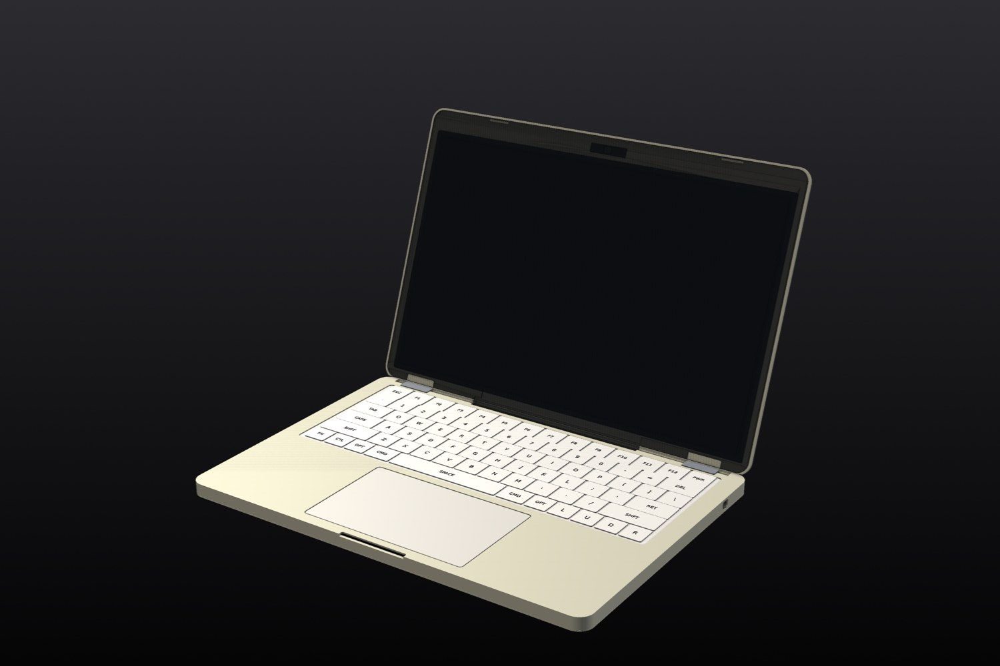<br>*Three-quarter view* | 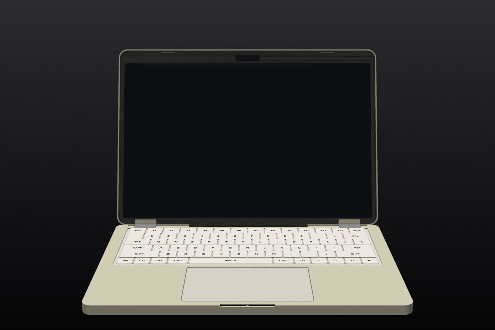<br>*Front* |
| 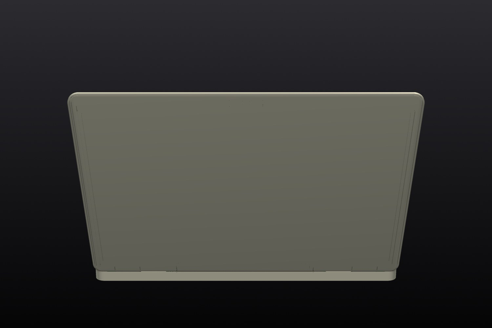<br>*Rear* | 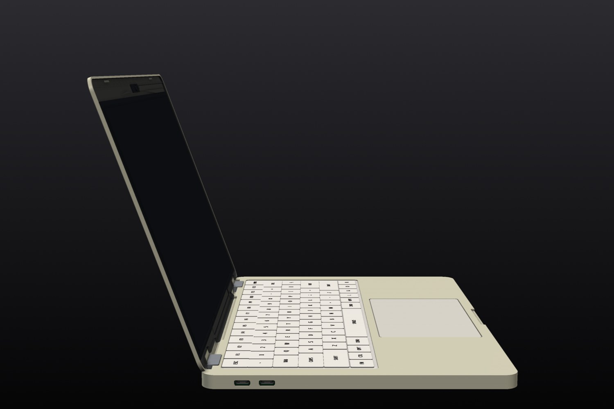<br>*Left side* |
| 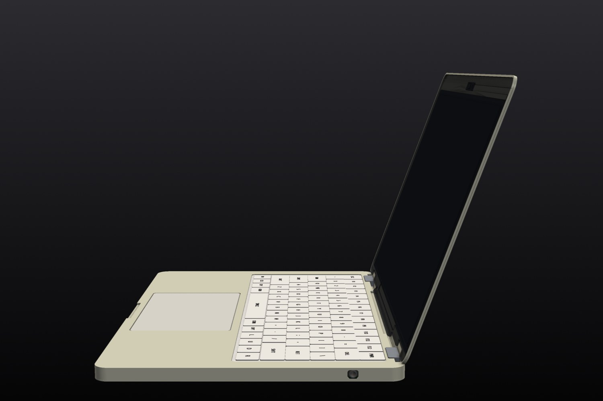<br>*Right side* | 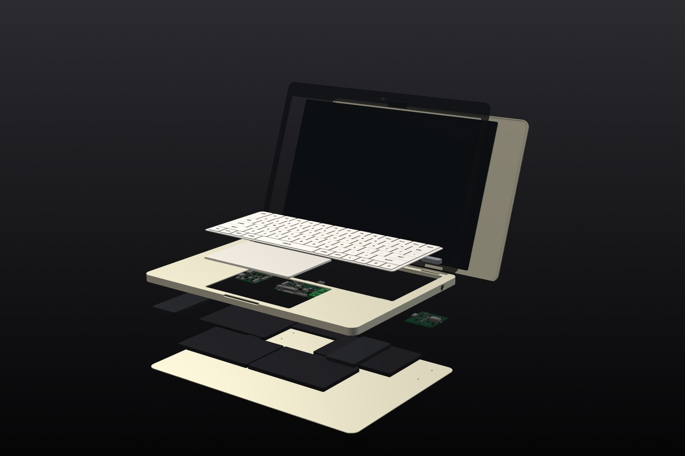<br>*Exploded* |
| 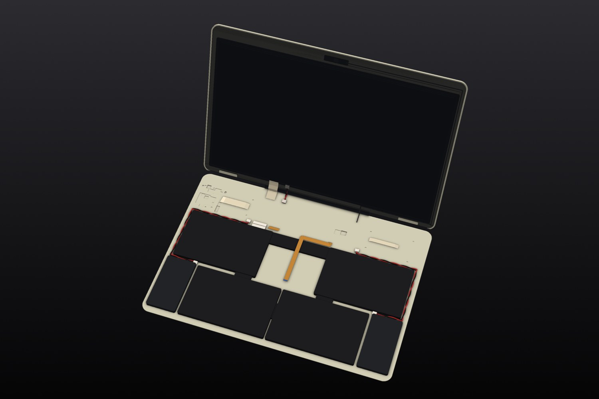<br>*Inside, top cover lifted away, every cable* | 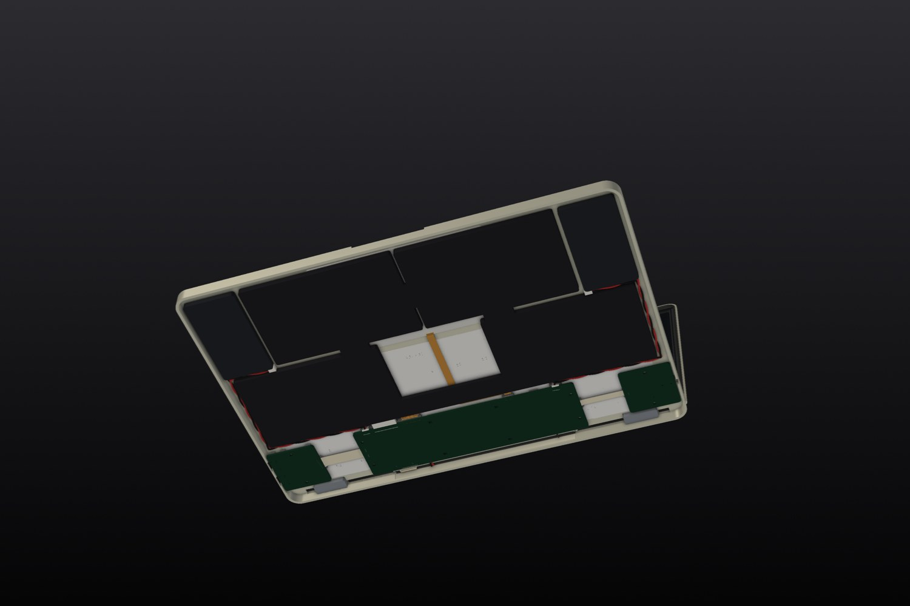<br>*Inside from below, bottom cover lifted away* |
| 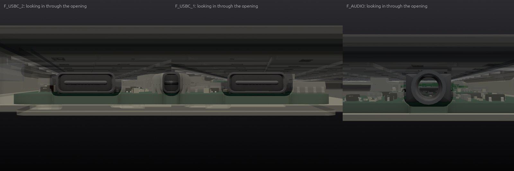<br>*Ports* | 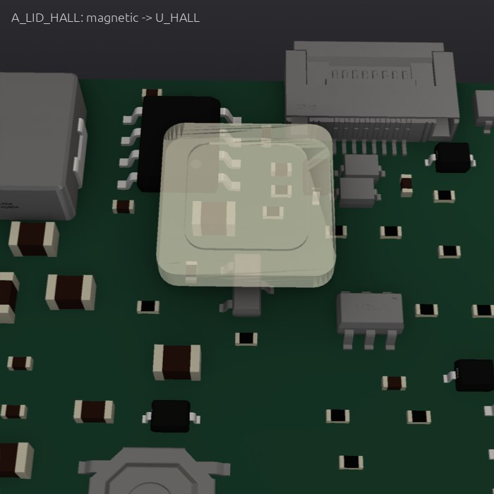<br>*Buttons and controls, next to the parts they press* |

## What's inside

**Power path:** USB-C PD sink (CH224A, asks for 20 V) → BQ25798 buck-boost charger with NVDC power path → one
2S2P pack of four identical LP4466104 cells (7.4 V, 9 Ah, 66.6 Wh) shaped around the trackpad → two 6 A 5 V bucks
(TPS56628) for the CM5 and the peripherals.

| Board | Size | Layers | Parts | Tracks | Vias | KiCad project | Review |
|---|---|---|---|---|---|---|---|
| Main board | 160 × 44 mm | 4 | 285 | 5,693 | 856 | [`hardware/thin-laptop-cm5.kicad_pro`](hardware/thin-laptop-cm5.kicad_pro) | [0 P0 · 0 P1](reviews/review-main.md) |
| Left Dual USB-C PD & Data Daughter Board | 36 × 38 mm | 4 | 67 | 1,218 | 93 | [`hardware/usb_left/thin-laptop-cm5-usb_left.kicad_pro`](hardware/usb_left/thin-laptop-cm5-usb_left.kicad_pro) | [0 P0 · 0 P1](reviews/review-usb_left.md) |
| Right Headphone & Microphone Daughter Board | 36 × 38 mm | 2 | 74 | 555 | 84 | [`hardware/audio_right/thin-laptop-cm5-audio_right.kicad_pro`](hardware/audio_right/thin-laptop-cm5-audio_right.kicad_pro) | [0 P0 · 0 P1](reviews/review-audio_right.md) |

**Bought parts** (modelled from their drawings; the assembly checks use these models):

- **Cm5 module**: Raspberry Pi Compute Module 5 (BCM2712 quad-core Cortex-A76, 8GB LPDDR4X, 64GB eMMC, Wi-Fi/BLE)
- **Keyboard module**: 78-key ANSI ultra-thin scissor-switch laptop keyboard module with printed legends and 24-pin 0.5mm FPC tail
- **Trackpad module**: Capacitive multi-touch glass-surface I2C laptop trackpad module with 8-pin 0.5mm FPC tail
- **Display panel**: 13.0-inch 2560x1600 4-lane MIPI DSI IPS thin LCD panel with integrated WLED backlight bar
- **Webcam module**: Slim 1080p MIPI CSI-2 camera module with 22-pin 0.5mm micro-coax receptacle for laptop top bezel
- **Battery pack**: Custom 2S2P 7.4V nominal
- **Speaker left**: Low-profile 8-ohm 2W rectangular laptop speaker box module (left channel)
- **Speaker right**: Low-profile 8-ohm 2W rectangular laptop speaker box module (right channel)
- **Hinge left**: Compact friction torque laptop hinge (left)
- **Hinge right**: Compact friction torque laptop hinge (right)

## How it was made

CopperPilot's agents worked from the prompt in [reference/prompt.md](reference/prompt.md) and 6 reference photos ([reference/](reference)). The pipeline scopes the product into a written contract ([design/spec.yaml](design/spec.yaml)), designs the boards and the enclosure in parallel, integrates them, and only moves on when the gates pass. A separate review agent reads every board against the part datasheets, and a separate judge compares the result with the photos.

- Pipeline wall clock: about **136 h** over 25 launches (pipeline v68 to v127).

**Reference vs build:**

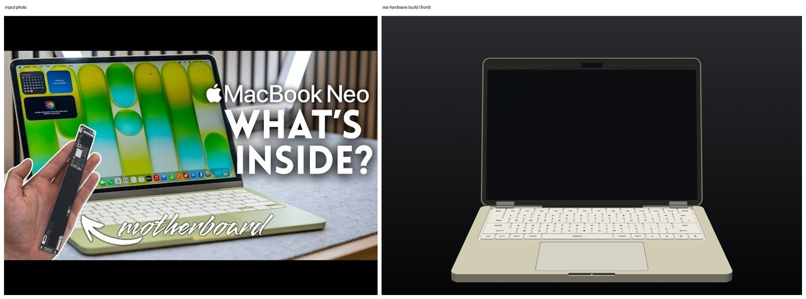
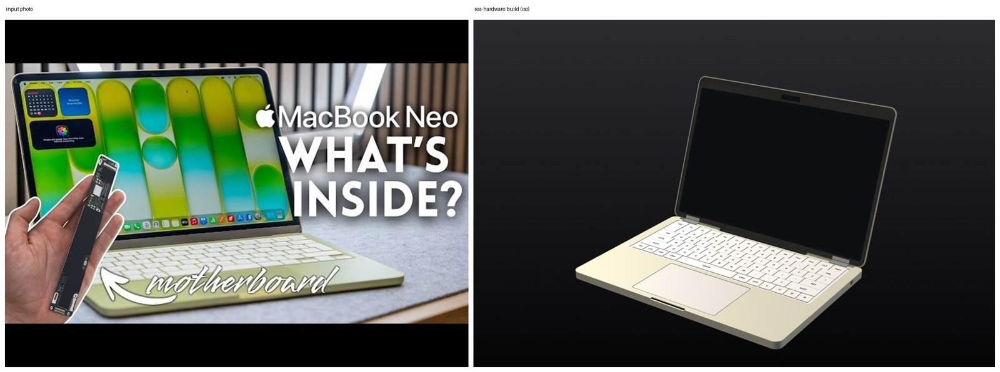
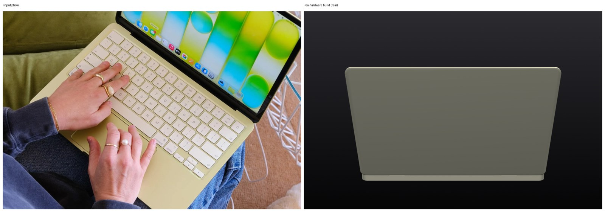

<sub>Reference photos of a commercial product, used here only for comparison. All rights belong to their owners; this project is not affiliated with or endorsed by the product's maker.</sub>

## Repository layout

```
hardware/          KiCad 10 projects (main board at the top, daughter boards in their own folders)
  lcsc.*, rea_refs.*   symbols, footprints and 3D models for every part, so the project opens anywhere
case/out/          enclosure parts (STL)
case/purchased/    bought parts used in the assembly checks
case/generate_case.py  the parametric enclosure source (uses CopperPilot's CAD helpers, not yet public)
fab/               Gerbers, drill, BOM, CPL, schematic PDF and STEP for each board; fab/mech/ enclosure STEP/STL
design/spec.yaml   the design contract the agents wrote and the gates check
reviews/           gate report, design reviews, the judge's notes, KiCad ERC/DRC
reference/         the prompt and the reference photos
docs/              build film and renders
```

## Manufacture

Every board targets **JLCPCB** standard PCB + assembly (1.6 mm FR-4); every part has an LCSC number. Per board: upload `*-gerbers.zip`, then `*-bom.csv` and `*-cpl.csv` for assembly, and check the part rotations in JLCPCB's preview before ordering.

The enclosure (`fab/mech/`) is designed for CNC-machined 6061 aluminium; STEP files are included for machining
quotes, STLs for test prints.

> [!WARNING]
> This design has not been built yet. Fix or accept the open review findings above before you order boards, and expect a first revision to need changes.

## Review this design

Hardware gets better with more eyes on it. We'd like to hear what you'd flag:

- **Open an issue** ([design review template](../../issues/new/choose)) for a wrong pin, a missing part, a tight clearance, a part you'd swap, or a P1 above you disagree with.
- **Send a pull request** with a fix. Say which board and which reference designators it touches.
- **Build one** and tell us how it went: photos, bring-up notes and failures are all welcome.

Start with [reviews/](reviews): every finding has its evidence and a suggested fix.

## License

[CERN-OHL-S-2.0](LICENSE). You may use, study, modify, make and sell products from this design; modified versions must be shared under the same licence.

Bought-part names and the Raspberry Pi Compute Module are named only to say what fits; all trademarks belong to their owners.

<p align="center"><a href="https://copperpilot.ai"><b>Designed by CopperPilot</b></a>: we accelerate hardware design.<br><sub>More open designs: <a href="https://github.com/CopperPilot">github.com/CopperPilot</a></sub></p>
